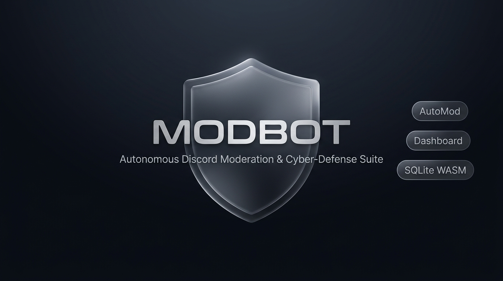
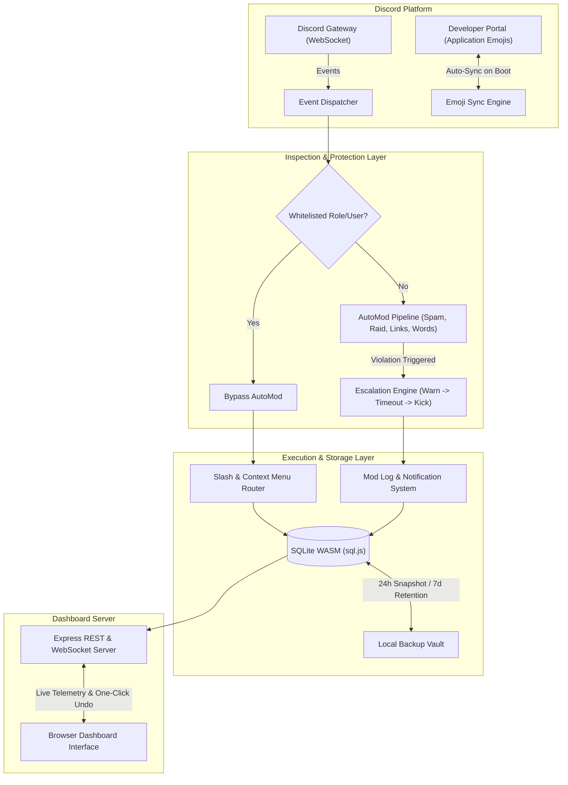

<p align="center">
  
</p>

<h1 align="center">ModBot</h1>

<p align="center">
  Production-grade Discord moderation and cyber-defense bot with a real-time web dashboard, SQLite WASM persistence, and autonomous application emoji sync.
</p>

<p align="center">
  <a href="#license"></a>
  <a href="https://nodejs.org/"></a>
  <a href="https://discord.js.org/"></a>
  <a href="https://sql.js.org/"></a>
  <a href="emojis.json"></a>
  <a href="#real-time-web-dashboard"></a>
</p>

---

## Overview

ModBot is an autonomous Discord moderation bot designed for high-concurrency communities. It eliminates external C++ build dependencies by leveraging SQLite on WebAssembly (`sql.js`), provides proactive server defense via a graduated auto-escalation engine, dynamically syncs 72 high-resolution vector application emojis, and includes a real-time web dashboard with one-click punishment revocation.

---

## Core Capabilities

### 1. Graduated Auto-Escalation Engine
- **Automated Sanctions**:
  - **3 Active Warnings**: Triggers an automated 1-hour timeout (`ModerateMembers`).
  - **5 Active Warnings**: Triggers an immediate guild kick.
- **Warning Expiry**: Warnings automatically decay and archive after 30 days (`active = 0`), preventing permanent penalty accumulation for reformed members.
- **Hierarchy Enforcement**: Validates role hierarchy before executing punishments to prevent unauthorized actions against equal or higher-ranked staff.

### 2. AutoMod Defense Pipeline
- **Anti-Spam**: Sub-second message frequency rate limiter detecting rapid message bursts.
- **Anti-Raid**: Monitors rapid join velocity spikes and isolates synchronized bot attacks.
- **Link & Invite Filter**: Regular expression scanner blocking Discord invite links and unauthorized domains.
- **Mass Mention & Emoji Limiter**: Restricts excessive user/role mentions and multi-emoji message flooding.
- **Regex & Keyword Wordlist**: Dynamic blacklists per guild with wildcard pattern support.
- **Whitelist Bypass Roles**: Designated roles configured via `/setup whitelist` bypass automated filters safely.

### 3. Autonomous Application Emoji Sync
- **72 Bespoke Duo-Tone Emojis**: 256x256 high-resolution vector icons rendered without background boxes.
- **Automated Boot-Time Provisioning**: Handled by `src/utils/appEmojiSync.js` using `@resvg/resvg-js`.
- **Zero Manual Setup**: On bot startup or token renewal, the engine checks the Discord Developer Portal for the `CLIENT_ID`, creates any missing application emojis via REST, and writes the mappings directly to `emojis.json`.
- **Dynamic Proxy Resolution**: `src/utils/emojis.js` exposes emoji references via a JavaScript Proxy with automated fallback handling.

### 4. SQLite WASM Database (`sql.js`)
- **Zero Native C++ Compilers**: Pure WebAssembly implementation eliminates `node-gyp`, Python, and Visual Studio C++ Build Tools dependencies.
- **Single-File Portability**: Database state is stored in `data/modbot.db`.
- **Automated Daily Backups**: Creates timestamped database snapshots in `data/backups/` every 24 hours with an automated 7-day rolling retention policy.

### 5. Real-Time Web Dashboard
- **Live Telemetry**: WebSockets-driven real-time stats including bot latency, memory consumption, active warnings, and open cases.
- **Case Management & One-Click Undo**: Search, filter, and review moderation logs with instant punishment revocation (`Undo`) directly from the browser.
- **Security & Session Layer**: Hardened with Helmet HTTP headers, strict Content Security Policy (CSP), Discord OAuth2 authentication, and express session security.
- **Default Address**: `http://localhost:3000` (configurable via `PORT`).

### 6. Discord Context Menu Applications
- **Message Context Menu**: Right-click message &rarr; **Apps** &rarr; `Delete & Warn` (instantly removes violating content and logs a warning).
- **User Context Menus**:
  - Right-click user &rarr; **Apps** &rarr; `Quick Mute (10m)` (immediate 10-minute timeout).
  - Right-click user &rarr; **Apps** &rarr; `View Warnings` (summary modal of active warnings).
  - Right-click user &rarr; **Apps** &rarr; `Check User History` (comprehensive case records, quarantine state, and ticket history).

---

## System Architecture



---

## Command Catalog

### Moderation Commands
| Command | Parameters | Description | Required Permission |
| :--- | :--- | :--- | :--- |
| `/ban` | `<user> [reason] [delete_days] [silent]` | Ban a member permanently with optional message pruning (0–7 days). | `Ban Members` |
| `/softban` | `<user> [reason]` | Ban and immediately unban to clear member messages without a permanent ban. | `Ban Members` |
| `/unban` | `<user_id> [reason]` | Revoke a ban by user ID. | `Ban Members` |
| `/kick` | `<user> [reason] [silent]` | Kick a member from the guild. | `Kick Members` |
| `/mute` | `<user> <duration> [reason] [silent]` | Temporarily timeout a member (e.g., `10m`, `2h`, `1d`). | `Moderate Members` |
| `/unmute` | `<user> [reason]` | Remove an active timeout immediately. | `Moderate Members` |
| `/warn` | `<user> [reason] [silent]` | Issue a formal warning subject to graduated auto-escalation. | `Moderate Members` |
| `/warnings` | `<user>` | Display all active warnings for a member. | `Moderate Members` |
| `/removewarn` | `<warn_id>` | Revoke a specific warning by its ID. | `Moderate Members` |
| `/case` | `<case_id>` | Retrieve or update details of a moderation case. | `Moderate Members` |
| `/search-user` | `<user/id>` | View complete moderation profile, case history, and tickets. | `Moderate Members` |
| `/purge` | `<amount> [filter_user]` | Bulk delete messages (1–100) with optional member filter. | `Manage Messages` |
| `/lockdown` | `[channel] [reason]` | Lock channel to prevent members from sending messages. | `Manage Channels` |
| `/unlock` | `[channel]` | Unlock channel and restore standard send permissions. | `Manage Channels` |
| `/slowmode` | `<seconds> [channel]` | Set the channel rate-limit cooldown (0–21600 seconds). | `Manage Channels` |

### Configuration & Protection
| Command | Parameters | Description | Required Permission |
| :--- | :--- | :--- | :--- |
| `/setup logchannel` | `<channel>` | Set the moderation audit log channel. | `Administrator` |
| `/setup modrole` | `<role>` | Assign the authorized moderator role. | `Administrator` |
| `/setup whitelist` | `<role>` | Assign the AutoMod bypass whitelist role. | `Administrator` |
| `/automod toggle` | `<feature> [enable]` | Enable or disable specific AutoMod defense modules. | `Administrator` |
| `/automod addword` | `<word>` | Add a keyword or regex pattern to the blacklist. | `Administrator` |
| `/automod removeword` | `<word>` | Remove a keyword or regex pattern from the blacklist. | `Administrator` |
| `/automod settings` | — | Display current AutoMod configuration and active filters. | `Administrator` |
| `/automod wordlist` | — | List all blacklisted words and patterns for the guild. | `Administrator` |
| `/ticket-panel` | `<channel> <title>` | Deploy an interactive button-based support ticket panel. | `Administrator` |
| `/verify-setup` | `<channel> <role>` | Deploy a one-click verification button for new members. | `Administrator` |
| `/selfrole-panel` | `<channel> <roles>` | Deploy an interactive role assignment panel. | `Administrator` |

### General & Analytics
| Command | Parameters | Description | Required Permission |
| :--- | :--- | :--- | :--- |
| `/boost` | `[user]` | Server Boost analytics, current tier perks, progress bar to next level, and active booster roster. | Everyone |
| `/top-members` | — | Display the guild message and engagement leaderboard. | Everyone |
| `/userinfo` | `[user]` | Inspect user account creation date, guild join date, roles, and avatar. | Everyone |
| `/serverinfo` | — | Display server statistics, owner, member counts, and channel counts. | Everyone |
| `/ping` | — | Check Discord Gateway WebSocket and REST roundtrip latency. | Everyone |
| `/botinfo` | — | Display system resource usage (RAM, CPU, Uptime, Node.js version). | Everyone |
| `/help` | `[command]` | Interactive select-menu command catalog and usage instructions. | Everyone |

### Context Menu Applications
| Action | Trigger | Description |
| :--- | :--- | :--- |
| `Delete & Warn` | Right-click Message &rarr; **Apps** | Deletes the message and logs a warning against the author in one click. |
| `Quick Mute (10m)` | Right-click User &rarr; **Apps** | Applies an immediate 10-minute timeout to the target member. |
| `View Warnings` | Right-click User &rarr; **Apps** | Opens a modal displaying the member's active warnings and timestamps. |
| `Check User History` | Right-click User &rarr; **Apps** | Displays full case history, alt quarantine status, and tickets. |

---

## Installation & Quick Start

### Prerequisites
- **Node.js**: `18.0.0` or higher.
- A Discord application registered in the [Discord Developer Portal](https://discord.com/developers/applications) with the following **Privileged Gateway Intents** enabled:
  - `Presence Intent`
  - `Server Members Intent`
  - `Message Content Intent`

### Step 1: Clone Repository
```bash
git clone https://github.com/EnzoNotNice/ModBot.git
cd ModBot
```

### Step 2: Install Dependencies
```bash
npm install
```

### Step 3: Configure Environment
Copy `.env.example` to `.env`:
```bash
cp .env.example .env
```
Fill in the parameters in `.env`:
```env
DISCORD_TOKEN=your_bot_token_here
CLIENT_ID=your_client_id_here
CLIENT_SECRET=your_client_secret_here
PORT=3000
SESSION_SECRET=your_secure_session_secret
DISCORD_REDIRECT_URI=http://localhost:3000/auth/discord/callback
```

### Step 4: Deploy Slash Commands & Context Menus
```bash
npm run deploy
```

### Step 5: Run Integrity Tests
```bash
npm test
```

### Step 6: Start Bot
```bash
npm start
```
*(For development with auto-reloading: `npm run dev`)*

---

## Environment Variables Reference

| Variable | Required | Description | Default / Example |
| :--- | :---: | :--- | :--- |
| `DISCORD_TOKEN` | **Yes** | Discord bot authentication token from Developer Portal. | `MTE...` |
| `CLIENT_ID` | **Yes** | Discord Application ID. | `1555744745609887786` |
| `CLIENT_SECRET` | No | Discord Application Secret (required for dashboard OAuth2). | `B-aby9M-0...` |
| `GUILD_ID` | No | Target guild ID for instant command registration during development. | `123456789012345678` |
| `PORT` | No | Web dashboard port. | `3000` |
| `SESSION_SECRET` | No | Cryptographic salt for dashboard session cookies. | `secure_random_key` |
| `DISCORD_REDIRECT_URI` | No | OAuth2 callback URL registered in Discord Developer Portal. | `http://localhost:3000/auth/discord/callback` |
| `NODE_ENV` | No | Runtime environment (`production` or `development`). | `production` |

---

## Production Deployment (PM2)

To run ModBot continuously 24/7 with auto-restart on crashes or server reboots, use PM2:

1. **Install PM2 globally:**
   ```bash
   npm install -g pm2
   ```

2. **Launch with configuration file:**
   ```bash
   pm2 start ecosystem.config.js
   ```

3. **Configure automatic startup on system reboot:**
   ```bash
   pm2 save
   pm2 startup
   ```

4. **Process Management Commands:**
   ```bash
   pm2 status          # Check process status and resource consumption
   pm2 logs modbot     # View live combined logs
   pm2 restart modbot  # Restart bot process
   pm2 stop modbot     # Stop bot process
   ```

---

## Security & Data Integrity

- **Server-Side Validation**: All moderation operations enforce guild permission bits and role hierarchy server-side prior to execution.
- **Data Sovereignty**: All cases, warnings, and guild configurations reside locally in the SQLite WASM database (`data/modbot.db`). No external telemetry or cloud database connections are utilized.
- **Automated Backup Rolling**: Database state is exported daily to `data/backups/`, keeping a rolling 7-snapshot retention window.
- **Repository Safety**: `.gitignore` strictly blocks `.env`, local database files (`*.db`), and backup directories from accidental commits.

---

## License

This project is licensed under the [MIT License](LICENSE).
